



  <a href="https://www.westpac.com.au/">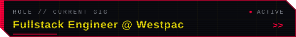</a>
  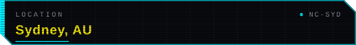
  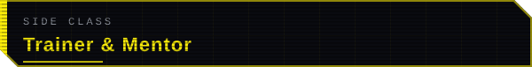
  <a href="https://koi.edu.au/">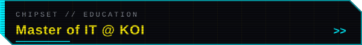</a>
  
  <a href="mailto:alimurtuza718@gmail.com">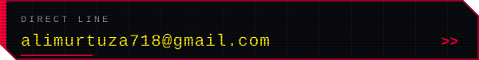</a>

<b>DECRYPT FULL BIO_</b>

 
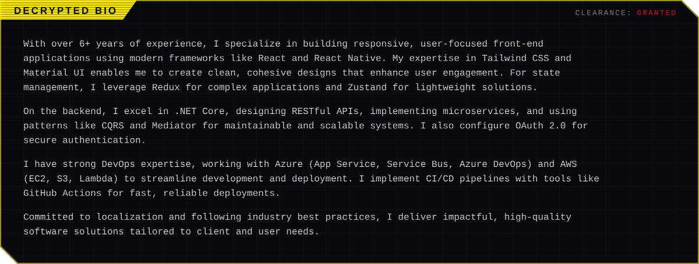

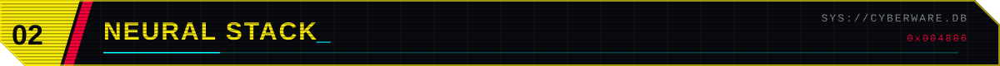

  
  <a href="https://maelogistics.com.au/">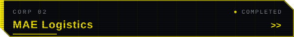</a>
  <a href="https://www.raenabeauty.com/">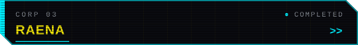</a>
  <a href="https://somee.social/">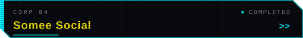</a>
  <a href="https://bizintel.co/">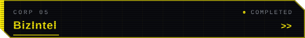</a>

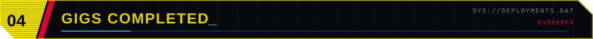

  <a href="https://ma3logistics.com.au/">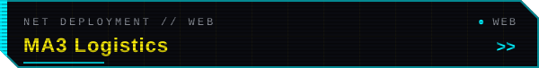</a>
  <a href="https://ayms.com.au/">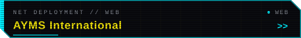</a>
  
  <a href="https://rdash360.com/">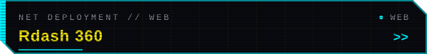</a>
  
  <a href="https://dresez.com/">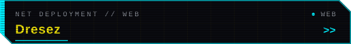</a>
  <a href="https://play.google.com/store/apps/details?id=com.raenaapp&hl=en&gl=US">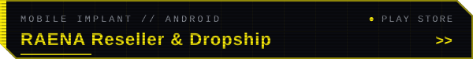</a>
  <a href="https://play.google.com/store/apps/details?id=com.someesocial&hl=en&gl=US">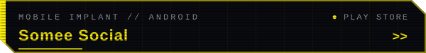</a>
  <a href="https://play.google.com/store/apps/details?id=com.beeplink.beep&hl=en&gl=US">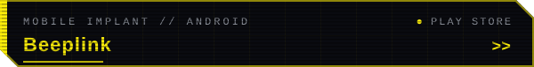</a>
  <a href="https://play.google.com/store/apps/details?id=com.wesync.kumbayah&hl=en_AU&pli=1">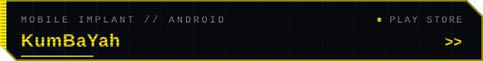</a>
  <a href="https://play.google.com/store/apps/details?id=com.bakier.co&hl=en&gl=US">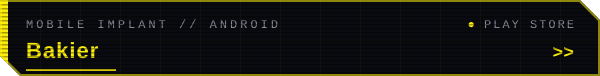</a>
  <a href="https://play.google.com/store/apps/details?id=com.codebusterspro.glowcalculator&hl=en&gl=US">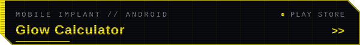</a>
  <a href="https://play.google.com/store/apps/details?id=macca.macca.bizintel&hl=en&gl=US">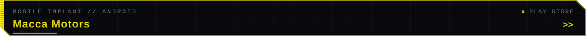</a>

  
  

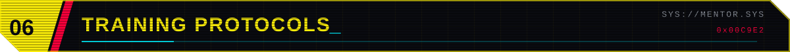
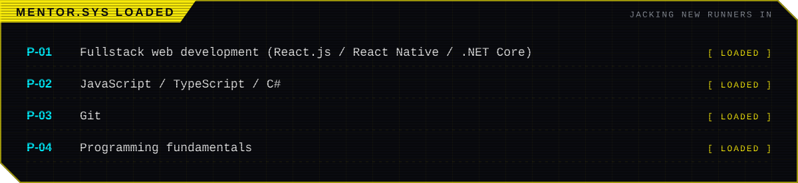

  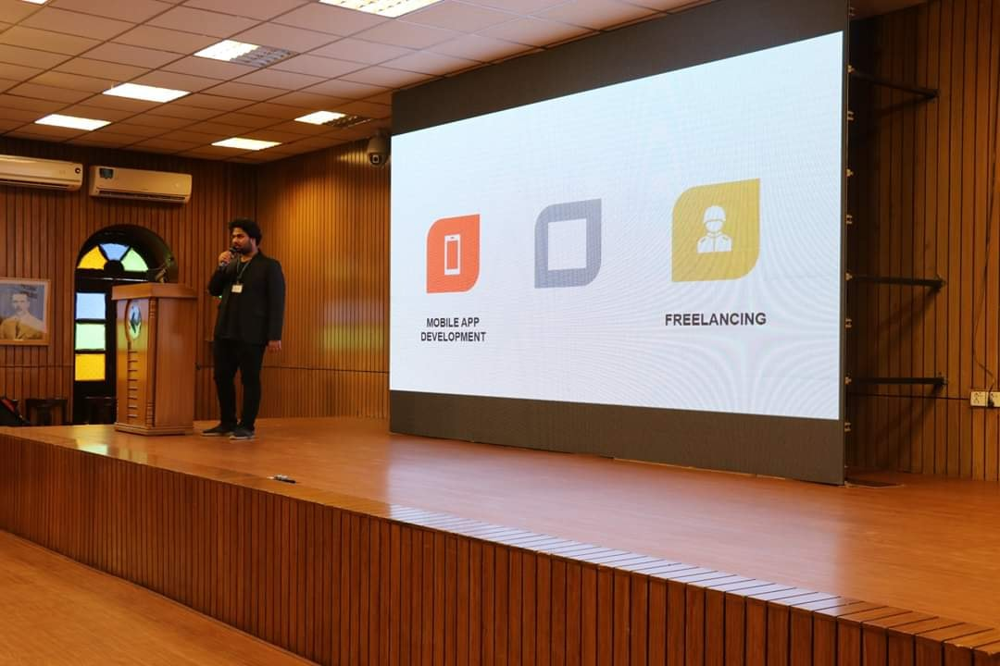
  
  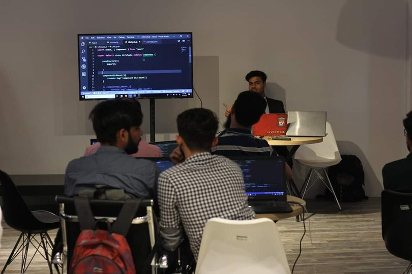
  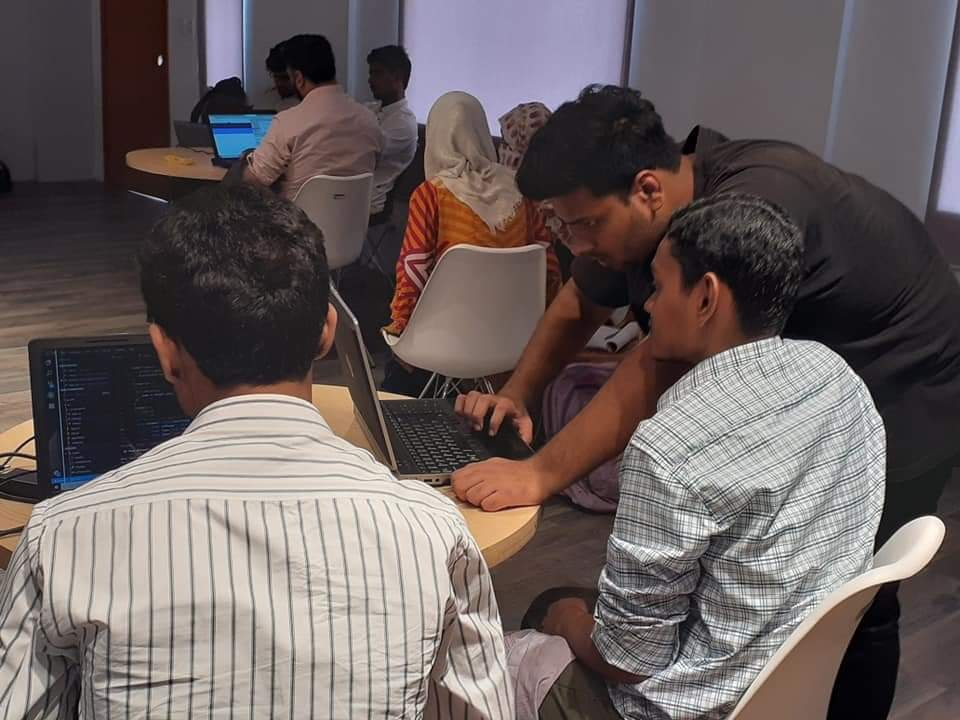
  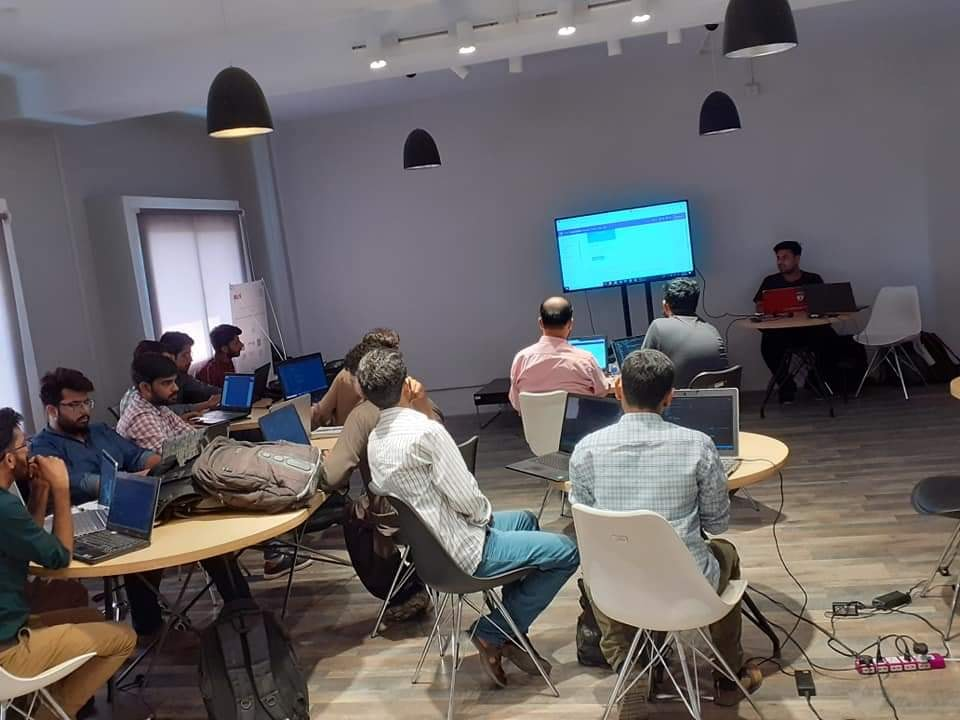

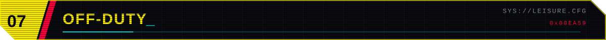
<a href="https://steamcommunity.com/id/haider718/">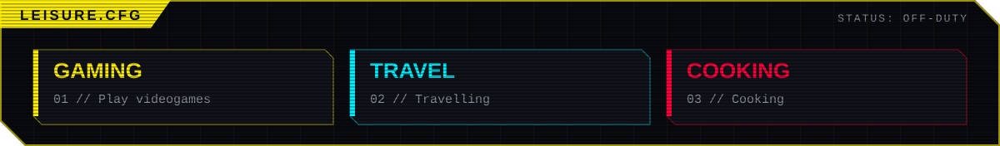</a>

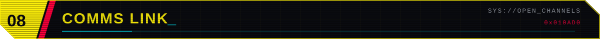

  
  
  
  
  
  
  

