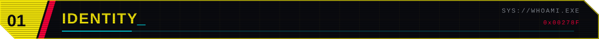
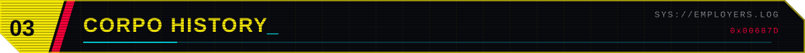
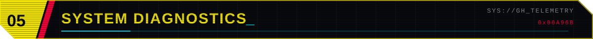
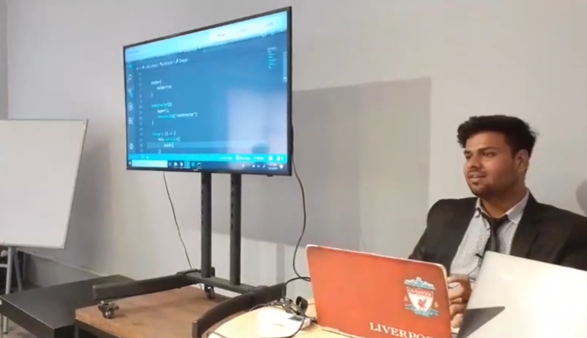
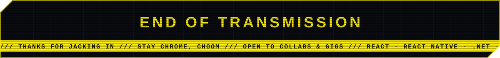

 

 

| ⟁ DATA SHARD | ⟁ VALUE |
| :-- | :-- |
| 💼 **ROLE** | Fullstack Engineer @ [Westpac](https://www.westpac.com.au/) |
| 👨‍🏫 **SIDE CLASS** | Trainer |
| 🎓 **CHIPSET** | Master of Information Technology, [Kings Own Institute](https://koi.edu.au/) |
| 🔗 **NETWORK** | [LinkedIn profile](https://www.linkedin.com/in/ali-haider-25a08b125/) |
| 📡 **DIRECT LINE** | [alimurtuza718@gmail.com](mailto:alimurtuza718@gmail.com) |

<b>▸ DECRYPT FULL BIO_</b>

 

With over <b>6+ years of experience</b>, I specialize in building <b>responsive, user-focused front-end applications</b> using modern frameworks like <b>React</b> and <b>React Native</b>. My expertise in <b>Tailwind CSS</b> and <b>Material UI</b> enables me to create clean, cohesive designs that enhance user engagement. For state management, I leverage <b>Redux</b> for complex applications and <b>Zustand</b> for lightweight solutions.

On the backend, I excel in <b>.NET Core</b>, designing <b>RESTful APIs</b>, implementing <b>microservices</b>, and using patterns like <b>CQRS</b> and <b>Mediator</b> for maintainable and scalable systems. I also configure <b>OAuth 2.0</b> for secure authentication.

I have strong <b>DevOps expertise</b>, working with <b>Azure</b> (App Service, Service Bus, Azure DevOps) and <b>AWS</b> (EC2, S3, Lambda) to streamline development and deployment. I implement <b>CI/CD pipelines</b> with tools like <b>GitHub Actions</b> for fast, reliable deployments.

Committed to <b>localization</b> and following <b>industry best practices</b>, I deliver impactful, high-quality software solutions tailored to client and user needs.

 

  

 

| 🏢 CORPORATION | 📶 CONTRACT STATUS |
| :-- | :-- |
| [**Westpac**](https://www.westpac.com.au/) | 🟨 `ACTIVE` |
| [**MAE Logistics**](https://maelogistics.com.au/) | ⬛ `COMPLETED` |
| [**RAENA**](https://www.raenabeauty.com/) | ⬛ `COMPLETED` |
| [**Somee Social**](https://somee.social/) | ⬛ `COMPLETED` |
| [**BizIntel**](https://bizintel.co/) | ⬛ `COMPLETED` |

 

| 🌐 NET DEPLOYMENTS · WEB | 📱 MOBILE IMPLANTS · APPS |
| :-- | :-- |
| ▸ [MA3 Logistics](https://ma3logistics.com.au/) | ▸ [RAENA Reseller & Dropship](https://play.google.com/store/apps/details?id=com.raenaapp&hl=en&gl=US) |
| ▸ [AYMS International](https://ayms.com.au/) | ▸ [Somee Social](https://play.google.com/store/apps/details?id=com.someesocial&hl=en&gl=US) |
| ▸ [Somee Social](https://somee.social/) | ▸ [Beeplink](https://play.google.com/store/apps/details?id=com.beeplink.beep&hl=en&gl=US) |
| ▸ [Rdash 360](https://rdash360.com/) | ▸ [KumBaYah](https://play.google.com/store/apps/details?id=com.wesync.kumbayah&hl=en_AU&pli=1) |
| ▸ [Linkstore (testing build)](https://stg.rdash360.com/linkstore) | ▸ [Bakier](https://play.google.com/store/apps/details?id=com.bakier.co&hl=en&gl=US) |
| ▸ [Dresez](https://dresez.com/) | ▸ [Glow Calculator](https://play.google.com/store/apps/details?id=com.codebusterspro.glowcalculator&hl=en&gl=US) |
| | ▸ [Macca Motors](https://play.google.com/store/apps/details?id=macca.macca.bizintel&hl=en&gl=US) |

 

  
  

  

  

  

 

> **`[ MENTOR.SYS LOADED ]`** I also run training sessions, jacking new runners into:

- ⚡ Fullstack web development (React.js / React Native / .NET Core)
- ⚡ JavaScript / TypeScript / C#
- ⚡ Git
- ⚡ Programming fundamentals

  
  
  
  
  

 

  
  
  

  

 

  
  
  
  
  
  
  

 

